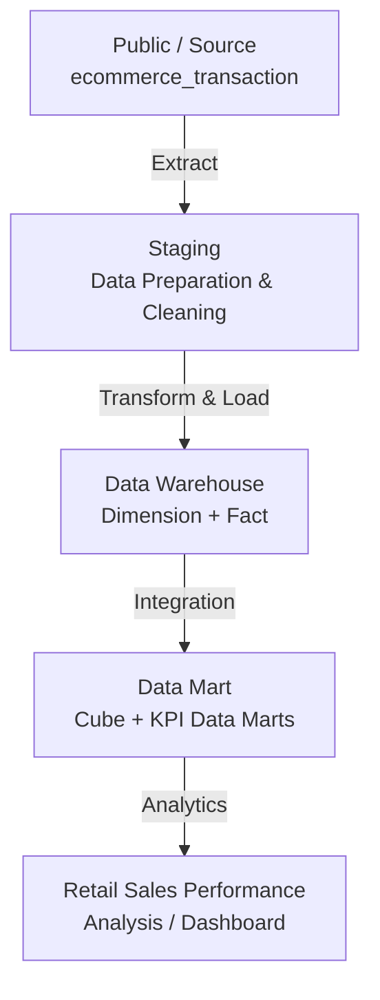
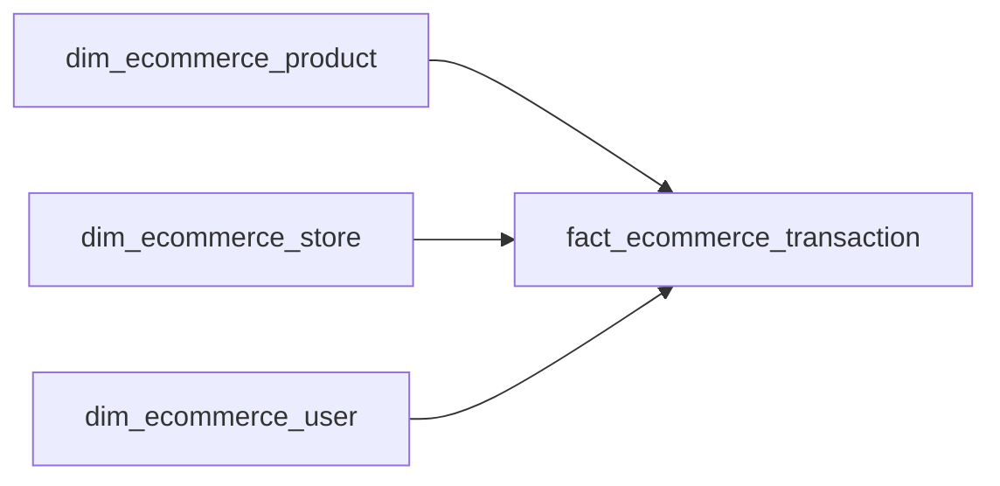

# E-Commerce Data Analytics: ETL Pipeline & Retail Sales Performance

## PostgreSQL ETL Pipeline

### ETL Overview

#### ETL

ETL (Extract, Transform, Load) is a data integration process used to extract data from source systems, transforms it into a consistent structure, and load it into a target system for analysis and reporting

#### Purpose

Building an ETL pipeline using PostgreSQL to transform raw e-commerce transaction data into structured, analytical-ready data for Retail Sales Performance Analysis 

#### ETL Scope

- Extract transaction data from the source table
- Load the data into the staging layer
- Perform data cleansing and transformation
- Create dimension and fact tables in the data warehouse
- Create a data mart cube and analytical data marts
- Automate the process using stored procedures 

#### ETL Architecture

The pipeline follows a layered architecture to transform raw e-commerce transaction data into analytical-ready data.



**Layers:**
- **Public**: source/raw transaction data
- **Staging**: initial data preparation and cleaning
- **Data Warehouse**: structured dimension and fact tables
- **Data Mart**: analytical cube and aggregated KPI tables
- **Retail Sales Analysis**: uses the processed data for business analysis and dashboarding

#### Analytical Purpose

The data processed through the pipeline is used as analytical-ready data to support retail sales performance analysis, including analysis of transactions, products, stores, quantities and revenue

#### Key Implementation

- PostgreSQL
- Staging layer
- Star schema
- Dimension & fact tables
- Data mart cube
- Range partitioning by transaction date
- Stored procedure for ETL automation
- Batch refresh strategy
- `TRUNCATE + INSERT` for staging and analytical data mart
- Duplicate prevention in fact loading

### Source Data

#### Source Table

```public.ecommerce_transaction``` is the raw transaction table that serves as the primary data source for the ETL pipeline.

#### Data Content
| Category    | Fields                                                          |
| ----------- | --------------------------------------------------------------- |
| Transaction | `id_transaksi`, `waktu_transaksi`, `transaksi_status`           |
| User        | `id_user`, `nama_user`, `gender_user`, `usia_user`, `kota_user` |
| Store       | `toko_id`, `toko_nama`, `toko_city`                             |
| Product     | `id_produk`, `produk_nama`, `produk_kategori`, `produk_harga`   |
| Sales       | `quantity`, `total_harga`                                       |
| Payment     | `payment_metode`                                                |
| Shipping    | `shipping_metode`                                               |

The source transaction table serves as the input to the ETL pipeline and is extracted into the staging layer for further processing.

### Staging & Data Transformation

The staging layer is used for initial data preparation and cleansing before the data is loaded into the data warehouse.

- Load extracted data into the staging table
- Add `last_update` as ETL metadata
- Handle missing values in `shipping_metode`
- Phone number fields were standardized by removing formatting characters while preserving the original numeric value
- Prepare the cleaned data for downstream processing

### Data Warehouse

The cleaned data from the staging layer is transformed into a structured data warehouse using a star schema. The data warehouse consists of dimension tables and a fact table.

#### Dimension Tables

- `datawarehouse.dim_ecommerce_product`
- `datawarehouse.dim_ecommerce_store`
- `datawarehouse.dim_ecommerce_user`

#### Fact Table

- `datawarehouse.fact_ecommerce_transaction`

Dimension tables store descriptive information about products, stores, and users, while the fact table stores e-commerce transaction records and measurable sales attributes such as quantity and transaction value.



### Data Mart Cube

The data mart cube integrates transaction data from the fact table with descriptive attributes from the product, store, and user dimension tables. The resulting dataset provides an analytical-ready structure for downstream aggregation and reporting.

#### Cube View
A data mart view is created by joining the fact transaction table with product, store, and user dimensions to provide a denormalized analytical view.

- Fact: `fact_ecommerce_transaction`
- Product: `dim_ecommerce_product`
- Store: `dim_ecommerce_store`
- User: `dim_ecommerce_user`

The resulting view is stored as:

`datamart.vw_dm_cube_ecommerce_transaction`

#### Physical Cube Table

The integrated data is loaded into the physical data mart cube:

`datamart.dm_cube_ecommerce_transaction`

The cube contains transaction, user, product, store, quantity, revenue, payment, transaction status, and shipping information.

#### Data Deduplication

Duplicate transaction records are handled using `ROW_NUMBER()` partitioned by transaction ID, keeping the latest record based on `last_update`.

#### Refresh Strategy
 
The physical cube table uses a full-refresh approach by truncating existing data and reloading the latest integrated data from the cube view.

`TRUNCATE → INSERT`

This ensures that the cube contains the latest integrated data before downstream KPI data marts are refreshed.

### Partitioning

The cube table is partitioned by `transaksi_date` using range partitioning, with one partition for each day.

Daily partitions are created for the transaction date range from `2025-01-01` to `2025-03-28`.

This partitioning strategy helps optimize time-based analytical queries through partition pruning and simplifies the management of historical transaction data.

### KPI Data Marts

The KPI data marts are created from the data mart cube to provide aggregated dataset for specific analytical requirements. Each data mart combines relevant business metrics with analytical dimensions to support transaction, product, store, and revenue analysis.

| Step | Data Mart                         | Metric                                      | Dimension | Analytical Purpose                   |
| ---- | --------------------------------- | ------------------------------------------- | --------- | ------------------------------------ |
| 10   | Most Transactions by Date         | `COUNT(*)`                                  | Date      | Analyze transaction volume over time |
| 11   | Total Transaction & User per Hour | `COUNT(id_sale)`, `COUNT(DISTINCT id_user)` | Hour      | Identify peak customer activity      |
| 12   | Total Quantity by Product         | `SUM(quantity)`                             | Product   | Analyze product sales volume         |
| 13   | Total Quantity by Store           | `SUM(quantity)`                             | Store     | Compare store sales volume           |
| 14   | Total Revenue by Store            | `SUM(total_harga)`                          | Store     | Compare store revenue performance    |


The KPI data marts provide pre-aggregated analytical dataset, while the data mart cube remains the primary detailed analytical source for broader business analysis and reporting.

### Stored Procedure & Automation

**Purpose:** The ETL workflow is automated using a PostgreSQL stored procedure to execute the data loading, transformation, data mart refresh, and partitioning processes as a single workflow.

#### Stored Procedure

CREATE OR REPLACE PROCEDURE datawarehouse.generate_ecommerce_transaction()
LANGUAGE plpgsql
AS $procedure$
BEGIN

    -- Step 1–14: ETL process

END;
$procedure$;

The `generate_ecommerce_transaction()` stored procedure encapsulates the ETL workflow into a single executable procedure. It is implemented using PostgreSQL PL/pSQL.

#### ETL Automation Workflow

                    CALL PROCEDURE
                         │
                         ▼
        generate_ecommerce_transaction()
                         │
        ┌────────────────┼────────────────┐
        ▼                ▼                ▼
    STAGING         DATA WAREHOUSE     DATA MART
        │                │                │
    Step 1            Step 2–5          Step 6–14
        │                │                │
    Cleansing       Dimension + Fact   Cube + KPI
        │                │                │
        └────────────────┴────────────────┘
                         │
                         ▼
                  Analytical Data
                         │
                         ▼
                     Power BI


| Stage      | Process                | Output                          |
| ---------- | ---------------------- | ------------------------------- |
| Step 1     | Load & cleanse staging | `stg_ecommerce_transaction`     |
| Step 2–4   | Load dimensions        | Product, Store, User            |
| Step 5     | Load fact              | `fact_ecommerce_transaction`    |
| Step 6–9   | Build & refresh cube   | `dm_cube_ecommerce_transaction` |
| Step 8     | Create partitions      | Daily transaction partitions    |
| Step 10–14 | Refresh KPI data marts | Analytical summaries            |

#### Refresh Strategy

The staging and analytical data marts use a batch full-refresh approach. Existing data is truncated and reloaded from the latest source or upstream analytical layer.

     Latest Source Data
            ↓
         TRUNCATE
            ↓
          INSERT
            ↓
       Refreshed Table

#### Partition Automation

Daily partitions are created as part of the ETL workflow before the cube before is loaded.

#### Execution

`CALL datawarehouse.generate_ecommerce_transaction();`

The complete ETL workflow can be executed through a single `CALL` statement instead of manually running each ETL step.

#### Automation Outcome

- Consistency: ETL steps are executed using a standardized workflow.
- Efficiency: Multiple SQL operations can be executed through a single procedure call
- Maintainability: ETL logic is centralized in one stored procedure
- Reusability: The procedure can be executed again when the source data needs to be refreshed

### ETL Validation

Data quality checks were performed after executing the ETL stored procedure to verify data completeness, transformation results uniqueness, and partition creation.

#### Record Count

| Layer | Row Count |
|---|---:|
| Source | 2,000 |
| Staging | 2,000 |

**Result:** PASS - The staging layer contains the same number of records as the source table.

#### Missing Value

| Layer | Missing `shipping_metode` |
|---|---:|
| Source | 1,324 |
| Staging | 0 |

**Result:** PASS - Empty values in `shipping_metode` were replaced with `Not Available` during staging transformation.

#### Duplicate Transaction

**Result:** PASS - No duplicate `id_sale` values were found in the data mart cube.

#### Partition Validation

The data mart cube was configured with daily range partitions from `2025-01-01` to `2025-03-28`.

| Validation | Expected | Actual |
|---|---:|---:|
| Daily partitions | 87 | 87 |

**Result:** PASS - ALL expected daily partitions were created.

#### Data Mart Output

The KPI data marts were checked to ensure that ETL process produced the expected analytical outputs.

**Result:** PASS - KPI data marts were successfully populated.

## Power BI Dashboard
The interactive dashboard presents the final analytical results and addresses the five business questions through the following views:

- Overall Performance Change
- Monthly Revenue and Transactions Trend
- Monthly AOV Trend
- Revenue Contribution by Category
- Top 5 Products by Revenue Contribution
- Revenue Contribution by Store City
- Transaction Distribution by Day and Time

The overall performance KPIs use comparable 28-day periods, while monthly trends use all available actual transaction data for each month.

### Retail Sales Performance Analysis


#### Background Business

Retail Crystal businesses generate sales transactions across multiple product categories and store locations. Monitoring sales performance is important to understand revenue trends, transaction activity, product contributions, and geographic performance.

This project analyzes retail transaction data from January 1 to March 28, 2025, to evaluate sales performance and identify patterns across products, categories, store cities, and transaction periods.

The analysis uses a structured PostgreSQL ETL pipeline and Power BI dashboard to transform transaction data into business insights that can support sales monitoring and decision-making.

#### Business Problem

The retail business generated revenue from multiple product categories and store locations during January–March 2025. However, an initial analysis of the transaction data identified a decline in sales performance.

Revenue decreased from Rp23.1 million in January (January 1–28) to Rp15.3 million in March (March 1–28), representing a 30% decline over comparable observation periods.

This situation highlights the need to evaluate changes in transaction volume and Average Order Value (AOV), assess revenue contributions across products, categories, and store cities, and understand transaction activity patterns.

The analysis aims to identify key sales performance patterns and areas requiring further business investigation to support data-driven decision-making.

#### Business Objectives

1. Evaluate changes in revenue, transaction volume, and Average Order Value (AOV) across comparable periods.
2. Identify the product categories and individual products contributing most to total revenue.
3. Evaluate revenue contribution across store cities.
4. Analyze transaction distribution by day of week and time of day.
5. Provide data-driven recommendations to support sales performance monitoring and business evaluation.

#### Questions Business

1. How did revenue, transaction volume, AOV change between comparable periods?
2. Which products and product categories contributed the most to total revenue?
3. Which store cities contributed the most to total revenue?
4. How were transactions distributed across different days and times?

#### Data Understanding

##### Dataset Overview

- Total records: 2000
- Fact table: Sales Transactions
- Dimension: Product, Store, User
- Analysis Period: January-March 2025

##### Feature Categories
- Product Information: Product Name, Category, Quantity, Total Price
- Store & Location Information: Province, City, Store Name
- Transaction Information: Order ID, Transaction Status, Payment Method, Shipping Method
- Time Information: Transaction Date, Transaction Time, Day Name, Month

##### Data Quality Issue
- Missing value shipping method

#### Analytical Methodology

The analysis uses the available transaction data from January 1 to March 28, 2025.

1. Monthly Performance Analysis

Monthly revenue, transaction volume, and AOV are calculated using all available transaction records within each month.

- Total Revenue: Sum of transaction revenue.
- Total Transactions: Count of distinct transaction IDs.
- Average Order Value (AOV): Total Revenue divided by distinct transactions.

2. Comparable Period Performance Analysis

To provide a fair comparison between January and March, the overall performance change uses an equal observation window:

- Starting Period: January 1–28, 2025.
- Ending Period: March 1–28, 2025.

Percentage change is calculated as:

Change (%) = (Ending Period Value - Starting Period Value) / Starting Period Value × 100%

The same comparable period is applied to revenue, transaction volume, and AOV.

3. Revenue Contribution Analysis

Product, category, and store city performance are evaluated based on their contribution to total revenue.

Revenue Contribution (%) = Revenue by Entity / Total Revenue × 100%

The Top 5 Products visual ranks products by revenue and displays their contribution to the overall revenue base.

4. Transaction Time Distribution

Transaction distribution is evaluated using the percentage of total transactions grouped by day of the week and time of day.

This analysis identifies transaction activity patterns rather than measuring revenue or operational capacity.

#### Key Business Insights

##### 1. Overall Sales Performance

- Revenue decreased by 30% between January 1–28 and March 1–28, 2025.
- Transaction volume declined by 9% over the same comparable periods.
- Average Order Value (AOV) decreased by 23%.

Business Insight:

The revenue decline was accompanied by decreases in both transaction volume and AOV. The larger decline in AOV indicates that the average transaction value also contributed to the overall revenue reduction.

##### 2. Product and Category Revenue Contribution

- Sports contributed 45.82% of total revenue.
- Home Appliances contributed 34.55%.
- Together, these two categories accounted for 80.37% of total category revenue.
- Under Armour Gym Bag and Philips Sonicare Toothbrush were the leading products in the Top 5 Products analysis.

Business Insight:

Revenue contribution was concentrated in the Sports and Home Appliances categories. The leading products also represented a substantial share of revenue within the product analysis, indicating the importance of monitoring key product performance.

##### 3. Geographic Revenue Contribution

- Medan recorded the highest revenue contribution at 18.19%.
- Semarang contributed 14.68%.
- Makassar contributed 14.65%.
- The three leading cities accounted for 47.52% of total revenue.

Business Insight:

Revenue contribution varied across store cities, with Medan representing the largest share among the locations analyzed.

##### 4. Transaction Distribution by Day and Time

- Midnight recorded the highest time-of-day transaction contribution at 25.95%.
- Morning followed closely at 25.85%.
- Wednesday recorded the highest daily transaction contribution at 15.25%.
- Transaction distribution was relatively balanced across the four time periods.

Business Insight:

Transaction activity was relatively evenly distributed throughout the observed time periods, with slightly higher contributions during Midnight and Morning. Wednesday also recorded the highest share of transactions among weekdays.

#### Conclusion

The Retail Sales Performance Analysis provides an overview of sales performance across revenue, transaction volume, AOV, product categories, store cities, and transaction activity patterns.

The comparable-period analysis identified a 30% decline in revenue, a 9% decrease in transaction volume, and a 23% decline in AOV between January 1–28 and March 1–28, 2025.

The revenue contribution analysis highlighted Sports and Home Appliances as the leading categories, while Medan recorded the highest contribution among the analyzed cities. Transaction activity was relatively balanced across different days and times.

These findings provide a basis for further investigation into declining sales performance, product contribution, geographic performance, and transaction activity to support business monitoring and decision-making.

#### Project Limitations

- The dataset covers January 1 to March 28, 2025, and does not represent a full calendar quarter.
- The analysis describes historical sales patterns and does not establish causal relationships behind revenue changes.
- Revenue contribution does not represent product profitability because product cost and margin information are not included.
- Transaction distribution percentages do not independently measure operational capacity or staffing requirements.

#### Recommendation

- Evaluate the factors behind the decline in revenue, transaction volume, and AOV. Further analysis can focus on product-level sales changes, transaction value distribution, pricing, and customer purchasing patterns.
- Prioritize inventory monitoring for leading products and major revenue-contributing categories. Evaluate opportunities for product bundling and cross-selling while monitoring their impact on average transaction value.
- Monitor sales performance in Medan, which recorded the highest revenue contribution. Compare product mix and sales trends across other cities to identify opportunities for improvement.
- Use transaction volume by day and time to evaluate operational activity. Further investigation into absolute transaction counts and operational capacity is recommended before adjusting staffing or service availability.
- Establish regular monitoring of revenue, transaction volume, AOV, and product and city contributions to identify changes in sales performance and support data-driven business evaluation.14:02


